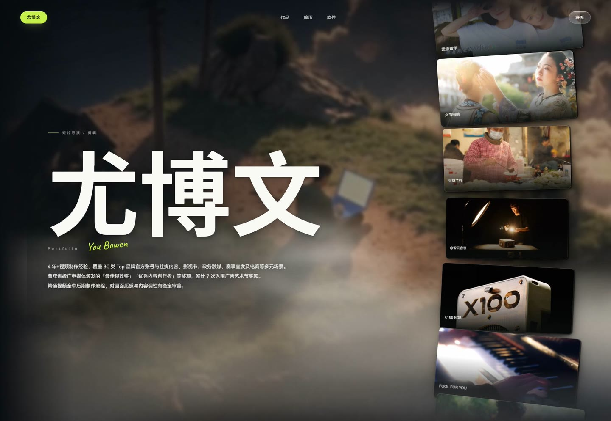

# 尤博文的个人主页

影像创作者的作品集 —— 导演 / 剪辑。15 个页面，纯静态。

**[→ 打开站点](https://soberbw-hash.github.io/soberbw/)**
　·　[作品](https://soberbw-hash.github.io/soberbw/work.html)
　·　[简历](https://soberbw-hash.github.io/soberbw/resume.html)
　·　[软件](https://soberbw-hash.github.io/soberbw/tools.html)
　·　[联系](https://soberbw-hash.github.io/soberbw/contact.html)



没有框架、没有构建工具链、没有 `npm install` —— 一个 Node 脚本把内容拼成 HTML。

---

## 一、现在是什么状态

| 项 | 情况 |
|---|---|
| 线上地址 | <https://soberbw-hash.github.io/soberbw/> |
| 目标域名 | `soberbw.cn` —— **还没绑定**（DNS 未配置），所以现在只有上面那个 github.io 地址能打开 |
| 页面数 | 15：首页 / 作品 / 简历 / 软件 / 联系 / 滚动浏览（browse）+ 9 个作品详情 |
| 部署方式 | GitHub Pages，`main` 分支，推上去约 1 分钟自动生效 |
| 资源指纹 | `site.css?v=700c3d4c`、`app.js?v=700c3d4c` —— 线上跑的是不是这一版，看这两个值 |

`canonical`、`og:url`、`sitemap.xml` 里写的都已经是 `https://soberbw.cn`。域名一绑上，这些就自动对上了；在那之前，它们指向一个还打不开的地址。

> 上面那张封面图 `img/readme-cover.jpg` 是 1920×1326 的线上截图缩到 1440 宽，只用在这份 README 里，页面本身不引用它。改了首页外观之后想换封面，重截一张、同样缩到 1440 覆盖即可。

### 最近一次改版改了什么（2026-10-26 凌晨，字幕玻璃片：字发虚 + 太挡图）

用户圈了悬停卡片的字幕框，两句话：「这个字体有点发虚」「下面液态玻璃显示名字的框框，能不能小一点，或者透明度能不能高一点？尽量不要影响到图片的预览」。

#### 字为什么发虚

不是渲染精度问题，也不是字号太小。是那个「液态玻璃」用的 **SVG 位移滤镜**。

```html
<filter id="sc-refract">
  <feTurbulence type="fractalNoise" baseFrequency="0.012 0.028" numOctaves="2" seed="11"/>
  <feGaussianBlur stdDeviation="5"/>
  <feDisplacementMap in="SourceGraphic" scale="14" xChannelSelector="R" yChannelSelector="G"/>
</filter>
```

`feDisplacementMap` 会按噪声把 `SourceGraphic` 的像素推歪最多 14px。用在 `backdrop-filter` 上时，Chrome 会把**元素自己的内容**也一起喂进去——于是字形的每一笔都被噪声推了一遍，看起来就是发虚、边缘起毛刺。

放大 3 倍做了四组对照：

| 变体 | 结果 |
|---|---|
| 当前 | 笔画边缘全是毛刺 |
| **去掉 `url(#sc-refract)`，只留 `blur()`** | **立刻锐利，玻璃质感一点没丢** |
| 去掉整个 `backdrop-filter` | 也清晰，但完全没有毛玻璃了 |
| 只加 `-webkit-font-smoothing:antialiased` | 没用，说明不是抗锯齿的问题 |

所以只删那个滤镜，`blur() saturate()` 留着。导航栏那个「联系」胶囊用的是同一个滤镜，一并删了，SVG 定义体也删掉（`<svg class="sc-defs">` 整块）。

#### 框为什么太大

`.cap` 原来是 `left:16px; right:16px`——框宽 = 卡片宽 − 32px，1920 下就是 **487px**，几乎横跨整张卡。悬停时那一片玻璃把照片下半截整个糊住了。

改成宽度跟着文字走：

```css
.sc-card .cap{ left:16px; right:auto; width:max-content; max-width:calc(100% - 32px); }
```

| | 改前 | 改后 |
|---|---|---|
| 框尺寸 | 487×63 | **118×60** |
| 占卡宽 | 92% | **22%** |
| 背景透明度 | `.24 → .07` | **`.14 → .045`** |
| 模糊 | 8px | **6px** |

透明度降了快一半、模糊也收小——糊得越狠越挡图。现在照片主体（人、灯、箱子）全都露在外面，字幕只在左下角占一小块。

### 上一次改版改了什么（2026-10-26 凌晨，卡片整体收 10%）

用户：「所有卡片整体都可以再小 10% 这个样子。」

在 `app.js` 里加了一个 `SHRINK = 0.9`，乘在 `cardW` 上：

```js
cardW = Math.min(W, H * 0.95) * QUIET * SHRINK;
```

乘在这一处，`cardH` / `pitch` / `setH` 全都跟着变——**带子的相对关系一点不改**，只是整条小一号。这是有意的：只缩卡片不缩间距，相邻两张的缝会从「微微重叠」变成「明显分开」，一列胶片就散成一排互不相干的卡，那是改另一件事。

实测四档都是 90.4%，居中偏差 0：

| 视口 | 改前 | 改后 | 比例 |
|---|---|---|---|
| 1920×1200 | 469.2 | 424.3 | 90.4% |
| 1440×900 | 393.3 | 355.9 | 90.5% |
| 1024×768 | 282.2 | 255.2 | 90.4% |
| 430×932 | 265.5 | 239.0 | 90.0% |

悬停那张也一起小：586.5 → 527.4（89.9%）。原来悬停时卡片正好长到 rail 内宽，现在留出 10% 余量，放大时更不容易碰到左右边缘。

一屏能看到的卡多了一张左右（1920 下从 6 张变成 7 张），带子读起来更长。

### 上一次改版改了什么（2026-10-26 凌晨，卡片阴影）

用户的原话：「这些卡片的阴影现在我感觉看得很硬、很深，很不自然。」

三个词对应三个具体的错：

| 症状 | 病因 |
|---|---|
| **很深** | 四层 alpha 是 `.62 / .58 / .64 / .72`。Ant Design 4.0 那套三层阴影是 `.16 / .12 / .09`——高了四倍。暗底上四层叠起来，卡片之间的间隙被压成死黑，整条带子像垫在一张黑纸上 |
| **很硬** | 第一层写的是 `4px 1px 2px rgba(0,0,0,.62)`：模糊只有 2px 配 .62 的透明度，等于一条实心黑边 |
| **不自然** | 悬停时 alpha 从 `.52` 升到 `.70`——越抬越黑。真实世界里物体离地面越远，影子越大越淡 |

两条外部依据：

- **Ant Design 的阴影规范**把高度分四层，明确写了「离地面越远的物体，影子越浅、模糊越大、面积越大；越近的越深、模糊越小、面积越小」。4.0 改成三层，就是为了「更柔、更真实」。
- **Superhuman 的暗色主题文章**：暗色主题里不要用纯黑，否则「没有比纯黑更黑的东西」，阴影就失去表达能力；层级应该靠表面亮度差来区分。

所以这次不是调参数，是换思路：**阴影从「黑色垫子」变回「空气」**。

```css
box-shadow:
  0 1px 3px -1px rgba(6,10,14,.26),   /* 接触影，几乎看不见 */
  0 8px 18px -6px rgba(6,10,14,.30),  /* 近影，体积 */
  0 22px 44px -16px rgba(6,10,14,.34),/* 中景，立体感主要来自这层 */
  0 48px 90px -32px rgba(6,10,14,.26);/* 远影，很淡 */
```

三个细节：

1. **颜色从 `rgba(0,0,0)` 换成 `rgba(6,10,14)`**。背景是暖色云海，纯黑影子压在暖色上会发脏，深蓝黑更接近真实阴影里带的那点环境色。
2. **横向偏移 4px 去掉了**。卡片在一条竖排的带子里，左右间隙一样宽，往右下偏会让每张卡看着都往右歪。
3. **悬停改成更大更淡**（`.18 → .22` 那一档往上调了一点，但整体仍比常态淡）。

效果：卡片之间那层死黑散开了，间隙亮度 29.8 → 36.2，背景的云能透进来。

> 试过但没采用的：给卡片加一圈 `0 0 0 1px rgba(255,255,255,.055)` 外描边来加强边界。`::after` 上已经有一圈 `inset 0 0 0 1px rgba(255,255,255,.09)` 内描边，再加外描边是重复的，而且 1px 白边在暗底上容易显得廉价。

### 再往前一次改版改了什么（2026-10-26 凌晨，片带左边那条竖边）

用户圈了一张截图：「放大的时候……也有一个类似阴影的东西，这是啥呀？」圈出来的是片带左侧一条从顶到底的竖带。

**先说结论：那不是多出来的元素，是卡片自己的影子被切了一刀。**

`.sc-card` 的 `box-shadow` 会一直铺到盒子外面（悬停时最远那层是 `10px 64px 120px -40px`，横向也散得开）。而 `.sc-rail` 上有 `overflow:hidden` 和一层遮罩，两者都沿着**边框盒**切一刀——影子铺到盒外就被切断，切口是一条笔直的竖边。平时卡片是缩小的（`QUIET = 0.80`），影子短，切在影子的尾巴上，看不出来；悬停放大到 `1/QUIET` 时影子变长，那条切口就露出来了。

#### 怎么确认的（六轮，别重复走）

| 做法 | 结果 | 结论 |
|---|---|---|
| `elementsFromPoint` 探 1240 / 1290 / 1305 / 1360 / 1400 | 1300 是 `.sc-rail` 左边界，1290 只命中 `main.sc-stage` 和 `body` | 没有外来元素，是 rail 自己的边界 |
| 差分：rail 改 `overflow:visible` | 变化 **0 px** | 不是 overflow 单独造成的 |
| 差分：rail 去掉 mask | 变化 **0 px** | 也不是 mask 单独造成的 |
| 差分：卡片去掉 `box-shadow` | 变化 37623 px | 暗带是影子画的 |
| 差分：卡片去掉 `::after` | 变化 55374 px | 暗带里有 `::after` 的渐变 |
| 只留片带、body 涂品红 | 片带自己画的，没有外来层 | — |
| **隐藏所有卡片** | **暗带完全消失** | **决定性证据：是卡片画的** |

`backdrop-filter`、`will-change`、`backface-visibility`、单层小阴影这四个假设都试过、都否掉了——去掉之后 1300 处的跳变一直在 9 级左右。

> 差分归因必须先把所有随机源冻住：视频 `currentTime` 固定、`reducedMotion` 冻片带、`.sc-sky` / `.sc-grain` 直接 `display:none`。少冻一样，差分全是噪声。

#### 改法

把 rail 的盒子往左撑开 120px，让那一刀落在离卡片 120px 外——影子在那里已经很淡；再叠一道 100px 的水平淡入，连这一刀都看不出来。

```css
.sc-rail{
  width:calc(var(--rail-w) + 120px);
  padding-left:120px;          /* 补回去，卡片位置一点不动 */
  padding-right:clamp(0px,2.2vw,34px);
}
```

`leftBase = padL + (W - cardW) / 2` 里那个 `padL` 是必须的：`padR` 是不对称的 `clamp(0px,2.2vw,34px)`，卡片要对齐的是**内容盒**中心，不是 padding 盒中心。撑开盒子之后 `clientWidth` 多了 120、`padL` 也多了 120，`W` 不变，`leftBase` 多 120——而 `.sc-track` 的 `inset:0` 是相对 padding 盒的，绝对位置正好抵消。

两层遮罩要用 `mask-composite:intersect` 取交集。默认是 `add`（并集），直接写两条 `mask-image` 会把上下淡出整个抵消掉——所以放在 `@supports` 里：**宁可没有左淡入，也不能丢上下淡出**。

第一版用的是百分比 `#000 9%`，在 1440×900 下算成 0px、在 390×844 下算成 65.5px（正好压在卡片上，把卡片左边也淡掉了）。改成固定 `100px` 之后四档都对。

#### 量出来的结果

| | 改前 | 改后 |
|---|---|---|
| 跨越 x=1300 那一步的列均值落差 | **9.02 级** | **0.80 级** |
| 主线程 Task/s（没回归） | 0.134 | 0.132 |
| 样式重算/s | 0.091 | 0.092 |

改前改后逐像素差分（悬停、背景全冻）：**x ≥ 1300 的变化是 0 px**，11656 px 的变化全部落在 1180..1300 那 120px 新露出来的区域。也就是说卡片本体、阴影、正文一像素没动，只是左边补上了原来被切掉的那截影子。

> 又一个测量坑：**别用「注入 `<style>` 改 CSS」来做这种 A/B**。`padL` 是 `measure()` 里读一次缓存下来的，注入样式改了 `padding` 之后 JS 不会重新 `measure()`，量到的是「CSS 改前 + JS 改后」的混合态。第一版就是这么量出「卡片偏移 58.6px」的假结果。正确做法是把文件真的写回去、重新 build、重新加载页面。

### 再往前一次改版改了什么（2026-10-26 深夜，首页掉帧）

用户的原话：「总感觉现在这个有点掉帧，卡卡的感觉」，「能不能加点动态模糊，或者把帧率调高一点」，后来又补了一句「现在帧率能不能搞个 60 帧或者 120 帧」。

先说结论：**不是帧率不够，是每帧干了太多活。** 把活减掉之后，再把该 60 的都提到 60。

实测（无头 Chrome，1440×900，首页静止，`Performance.getMetrics` 取 3s 增量）：

| 状态 | 主线程占用 | 其中样式重算 |
|---|---|---|
| 片带在走（改之前） | 0.53 s/s（53%） | 0.47 s/s |
| 片带在走（改之后） | 0.14 s/s（14%） | 0.09 s/s |
| **指针停在带子上**（`paused`，一帧都不写 transform） | **0.05 s/s** | **0.00** |

第三行是关键：只要不写 transform，这一屏几乎没有开销。也就是说那半秒 CPU 全花在「给 9 张卡每帧写一次 `style.transform`」上——一次写入就是一次样式重算。

改法两条，都不动观感：

| 改了什么 | 具体 | 为什么 |
|---|---|---|
| 高刷屏封顶 60fps | 隔不到 14ms 就跳过这一帧（`dt` 跨过被跳掉的时间，积分不少算） | rAF 跟着屏幕刷新率跑。144Hz 屏上这段开销是 60Hz 的 2.4 倍，而带子一帧只挪 0.3px，多出来的帧纯属白烧 |
| 位置按 0.5px 量化 | 没跨过半像素就不写，连 `dv / scale / rotate` 都不算；快滚（>240px/s）自动回到 0.1px 精度 | 常态漂移 18px/s、一帧 0.3px，量化之后约每两帧才真写一次。0.5px 在这个尺寸上是亚像素 |

改完之后实测带子还在正常走：1.5s 位移 29.4px（理论 27px，差值来自采样窗口）、单步最大 **0.554px**、每秒变化 36 次。**没有台阶，没有停顿。**

#### 然后把两处真正低于 60 的提到 60

| 层 | 原来 | 现在 | 代价 |
|---|---|---|---|
| 云海 canvas | 30fps（`t - last < 30` 直接 return） | 跟着刷新率，封顶 60fps | 主线程 0.133 → 0.127 s/s，**在噪声内**（canvas2d 的画图命令走光栅线程，不占主线程） |
| 背景片 | 源片 24fps | `minterpolate` 插值到 60fps，1120×626 不变 | 文件 311KB → 853KB，解码在主线程之外 |

云海那个 30fps 是当初「30 和 60 观感一样、成本差一倍」的推理定下的——前半句对（云一帧只挪 0.07–0.43px），后半句**当时没量**。量完发现不要钱，就没有理由只给 30。

背景片是 24fps 的源，在 60Hz 屏上本来就是 3:2 的节奏差，这是「看着不如界面顺」的一个来源。`minterpolate`（`mi_mode=mci:mc_mode=aobmc:me_mode=bidir:vsbmc=1`）插到 60fps，逐帧看没有拖影。**注意：插值只补帧，不改变内容的运动**；如果以后换片，记得重新跑一遍这条命令。

#### 为什么没做 120fps

带子一帧挪 0.3px，云一帧挪 0.07–0.43px——**都已经在亚像素范围**。120Hz 屏上把这两层提到 120fps，多出来的帧画的是同一批像素，肉眼不可能分辨，只是把光栅带宽烧掉一半。所以封顶放在 60。

真要看 120fps 有意义的地方，得是「一帧移动几十像素」的东西——比如快速甩滚轮时带子瞬间到 2000px/s，那时候一帧 33px。但那是滚动过程，不是常态，为它常年付 120fps 的账不划算。

#### 为什么没加「动态模糊」

动态模糊是给「一帧移动几十像素」的东西用的——那种情况下眼睛看到的是重影，补上模糊才连续。这里带子一帧移动 0.3px，比一个像素还小，**没有东西可以糊**。加了只会多一层每帧要重算的滤镜（`filter: blur()` 会让元素退出合成器快路径），把帧率再拉低一截——正好和需求相反。

> 顺带记一个测量上的坑：这个指标的**run-to-run 波动有 ±30%**（同一个 base 三次跑出 0.47 / 0.62 / 0.53）。单次对比得出的任何结论都不可信。改前改后各跑 3 轮取中位数，才看得出 53% → 14% 这种量级的差别。另外「注入一个 `<style>` 标签」本身就会让每次样式重算变慢，做 CSS 消融实验时**每个变体都要注入**（包括空规则），否则量到的是注入带来的开销。

### 再往前一次改版改了什么（2026-10-26，片带的立体感 + 滚轮惯性 + 名字字重 + 左边缘）

用户提了四点：右侧片带「立体感不强、想加点圆角和阴影」；「鼠标滚轮翻作品要缓动、要有刹不住车的感觉，现在是直上直下」；名字「有点粗」；首页左边「有个什么黑边」。改法如下：

| 位置 | 改成什么样 | 为什么 |
|---|---|---|
| 首页左边缘 | 左侧压暗从 `100deg` 改成 `90deg`，最左端直接落到页面底色 `#0B0F12`，12% 内化开 | 见下面「那条黑边到底是什么」——不是多余元素，是画面本身的亮条贴着边框 |
| 片带·滚轮 | 滚轮给的是**冲量**不是位移：一格 = 1100px/s 的初速，靠摩擦滑行 200px（约一张卡），完全停住约 800ms | 原来写的是 `offset -= dy`，一格滚轮带子瞬移 100px，中间一帧过渡都没有。现在是「推一把 → 加速 → 滑行 → 收住」 |
| 片带卡片·圆角 | 4px → 12px | 4px 在 393px 宽的卡上只占 1%，肉眼就是直角，卡片像从网页上直接抠下来的。12px 读得出「一张有厚度的卡」，又没到 20px 那种 App 卡片、把胶片感洗掉 |
| 片带卡片·阴影 | 一层 → 四层（接触 / 近 / 中 / 远），横向偏移 4–6px | 原来只有 `0 20px 44px -26px`：偏移 20 配负收束 26，影子被缩成一小片垫在卡下面，深色背景上等于没有。四层分工见 `site.css` 注释 |
| 片带卡片·亮边 | 上沿 1px `rgba(255,255,255,.22)` + 四周 .09 轮廓，画在 `::after` 上 | **深色背景上，分离靠亮边不靠黑影。** 亮边不能写成父级的 inset 影——inset 影画在子元素之下，会被 `::after` 的压暗渐变吃掉 |
| 片带卡片·悬停 | 近影收紧、远影铺开，亮边提亮 | 只放大不换影子，放大就只是变大，不是往前 |
| 名字字重 | 思源黑体 800 → 700（新子集 `fonts/display/sans-name-700.woff2`，4KB） | 800 撑到 216–300px 之后横竖都偏厚，整块字「闷」。700 笔画的粗细差回来了，「博」里那些小横之间透出气；再往下到 600 就发飘，在照片上压不住 |

滚轮那几个数不是拍脑袋定的，实测曲线（帧级采样，1440×900）：

| 操作 | 总位移 | 单帧最大位移 | 停住 |
|---|---|---|---|
| 一格滚轮 | 200px（≈1.1 张卡） | 16.2px | 约 800ms |
| 五格快滚（40ms 一格） | 1026px（≈5.5 张卡） | — | — |
| 三格向下后两格向上 | 峰值 398px，回落到 202px | — | 方向反得回来，不僵 |
| 减少动态（`prefers-reduced-motion`） | 100px | 100px（**一帧到位**） | 0ms，无惯性 |

### 那条黑边到底是什么（排查记录，别重复走一遍）

用户圈了首页左边一条竖着的暗带。**先别急着改 CSS——它不是元素。**

排查顺序和结论：

1. 在那个位置点 `document.elementsFromPoint`，只返回 `main.sc-stage` 和 `body` —— 说明没有多余元素盖着。
2. 逐个 `display:none` 掉 `video.sc-film` / `canvas.sc-sky` / `.sc-veil` / `.sc-grain`：
   - 关掉 **video** → 那条竖带的形状完全消失（整行变成平的 24–27）；
   - 关掉 canvas / veil → 形状不变，只是整体亮度变了。
   结论：**来自背景片本身**。
3. 把 `video` 单独截出来（其余全隐藏、body 涂成品红确认铺满）：左边那条「亮竖条」是悬浮岛左边、岛外那片亮云；紧挨着它的就是岛子的背光暗部。一亮一黑贴着视口边框并排 → 看起来就是「一条黑边」。
4. 顺手量了一遍：左侧压暗用的是 `linear-gradient(100deg, …)`，等值线是斜的（倾斜 10°），1326px 高的屏上边界横向差 234px。一个「左边压暗」用斜渐变本来就写错了。

改法：`100deg → 90deg`；最左端直接落到页面底色 `#0B0F12`、12% 内化开，把那条亮条压进过渡里，边框和页面同色就不可能再有缝。同时把片子的 `brightness` 从 .80 提到 .86——那块背光面本来就被压死成纯黑，提一点回来还能看出岩石和草的层次；**有层次的暗才是「暗」，没有层次的黑就是「边」**。

> 踩坑提醒：排查时一开始拿用户截图和本地渲染逐像素对比，结论全是错的——用户截图是 **1920×1326**，我按 1080 宽度在比。**先 `ffprobe` 确认截图尺寸，再谈坐标。**

上一轮是**手机端**，桌面端外观没变（首页仍是「左边巨型名字 + 右边竖着走的胶片」），手机端从「能打开」变成「好用」：

| 位置 | 改成什么样 | 为什么 |
|---|---|---|
| 首页片带（手机） | 从「屏底横带里竖着拖」换成「横着走的胶片」，手指左右划翻片，上下划滚页面 | 原来整条带子是 `touch-action:none`，手指按上去页面就滚不动了；而且横带里竖着拖，谁也不会这么操作 |
| 卡片拖拽（全端） | 按住拖动真正 1:1 跟手 | 卡片是 `<a>`，浏览器把它当「拖拽链接」，一拖就发 `pointercancel` 掐断手势。现在 `dragstart` 上拦掉原生拖放 |
| 顶栏链接（手机） | 点击区 25×24 → 41×49 | 12.5px 的字，上下只有行高，拇指按十次点空三次。下划线改用 `::after` 画，点击区随便撑 |
| 详情页 / 软件页 / 联系页 / 页脚链接 | 全部撑到 44px 高（页脚用透明 `::after` 扩，版式不动） | 同上，Apple HIG 与 Material 的底线都是 44×44 |
| 首页（短屏 360×640 / 390×667） | 收顶距、名字 88→70、简介上边距收紧，保证一屏装下 | 原来会多出 60px 滚动，滚一下发现后面什么都没有，像没做完 |
| 首页（iPad 竖屏 820×1180） | 名字块竖向居中，片带定高贴底 | 原来名字贴顶、带子贴底，中间空出三百多像素，像漏了一块 |
| 滚动浏览页（手机） | 屏底那颗进度点收掉 | 它是 `fixed` 的，内容从底下滚过去，正好把卡片字幕从中间截断；顶栏四个链接跳的是同样四个位置，功能重复 |
| 手机浏览器地址栏 | 深色页 `#0A0A09`、浅色页 `#F5F4F0` | 原来全站都是浅色值，深色页顶部会露一条浅色边 |

上一轮（详情页 + 二级页视觉改版）改的是**打开就能看出来**的地方：

| 位置 | 改成什么样 | 为什么 |
|---|---|---|
| 详情页首屏 | 身份 / 发布 / 年份 + 观看入口，从标题下面那一小坨 `dl` 挪到首屏底部，拉成一条横贯的 credits 带 | 原来这四样跟标题抢同一块注意力，标题再大也压不住 |
| 详情页剧照墙 | 通栏权限改成按源图像素宽度发；竖版封面不再裁成 2:1 | 原来无条件让最后一张跨两列，714px 的剧照被拉到 1330px，放大 1.86 倍，糊得很明显 |
| 详情页「关于」 | 标签挪进左边距当书眉，第一段提一档当导语 | 原来是「小标签 + 三行一样大的字」，没有入口 |
| 详情页页尾 | 「下一部」带一张封面，两边标题底对齐 | 原来两边都是两行小字，读到页尾就没气了 |
| 二级页页头 | 作品 / 软件 / 联系 / 简历的标题从 37px 提到 76–84px；软件页简介挪到右栏贴底 | 37px 只比卡片标题大一倍，一进页面眼睛不知道往哪落；软件页右边 850px 全空 |
| 作品页 | 九部一大两小的编辑式混排（上一轮做的） | 六张一样大的卡是模板感最重的地方 |

下面「八、剩下的事：哪些只能你做」里列的，都是**必须本人出手**的部分——没有素材、没有口述，写不了。

---

## 二、换一台电脑怎么接手（最短路径）

这个仓库只是**发布源**（站点成品）。原始素材、研究记录、全部 `tools/` 脚本和每天的工作日志在另一个**私有**仓库 **`soberbw-hash/soberbw-workspace`** 里——那里才是工作区。

```bash
# 只改文案、改样式：克隆这个仓库就够
git clone https://github.com/soberbw-hash/soberbw.git
cd soberbw
node _src/build-site.mjs        # 重新生成全部 HTML
```

```bash
# 要从头做（换素材、改版式、看每一轮为什么这么改）：两个都要
git clone https://github.com/soberbw-hash/soberbw-workspace.git   # 私有，要登录
cd soberbw-workspace
git clone https://github.com/soberbw-hash/soberbw.git site         # 构建脚本要从 site/ 读图片和视频
node tools/build-site.mjs
```

改内容 → 重跑这一句 → `git add -A && git commit -m "说明" && git push`。等一分钟就上线。

不需要装任何依赖。Node 18 以上即可（用到了 `node:fs` / `node:crypto` 的标准 API）。

> **最重要的一件事：不要直接改 `.html` 文件。**
> 那 15 个页面是 `_src/build-site.mjs` 生成出来的，下次构建会被整段覆盖。
> 要改内容，改 `_src/build-site.mjs` 里的数据区块，然后重跑。

---

## 三、仓库里有什么

| 路径 | 是什么 | 能不能直接改 |
|---|---|---|
| `_src/build-site.mjs` | **唯一的内容源**：作品、履历、联系方式、软件项目、页面模板 | ✅ 改这个 |
| `_src/deploy.mjs` | 在工作区里用的部署脚本（仓库里这份只是快照） | 一般不用 |
| `assets/site.css` | 全部样式，约 1800 行 | ✅ |
| `assets/app.js` | 首页：云层 canvas、右侧片带、字体加载、页面转场 | ✅ |
| `assets/scroll.js` | 滚动浏览页（browse）的分屏吸附与进度点 | ✅ |
| `assets/copy.js` | 联系页的「点击复制微信号」 | ✅ |
| `index.html` / `work.html` / … | 生成结果 | ❌ 会被覆盖 |
| `img/` `fonts/` `media/` | 剧照、字体子集、首页背景视频 | ✅ 可以加 |
| `sitemap.xml` / `robots.txt` | 构建时自动生成 | ❌ 会被覆盖 |

`_src/` 这个目录名带下划线，GitHub Pages 的 Jekyll 会跳过它，所以它不会作为页面发布出去——但它在仓库里，`git clone` 拿得到。

---

## 四、内容在 build-site.mjs 的哪一块

打开 `_src/build-site.mjs`，往下找这几个常量：

| 常量 | 管什么 |
|---|---|
| `WORKS` | 6 部横屏作品：MV、人物短片、旅拍 |
| `VERTICAL` | 3 部竖屏 / 商业作品：智云、X100 RGB、球星赛预热 |
| `ALL_ORDER` | **作品页的陈列顺序**，也是详情页「上一部 / 下一部」的顺序 |
| `EXPERIENCE` | 工作经历（含绿联那条占位） |
| `RESUME_HEAD` | 简历顶部的基本信息：电话、邮箱、性别、年龄 |
| `TOOLS` | 软件项目 |
| `CONTACT` | 联系页的电话 / 邮箱 / 微信 / GitHub |
| `SITE` | 站点根地址，改域名只改这里 |

**加一部作品**：在 `WORKS` 或 `VERTICAL` 里加一条 → 把 slug 加进 `ALL_ORDER` → 剧照放进 `img/work/` → 重跑。漏掉 `ALL_ORDER` 会直接抛错（脚本里有 `throw`），不会悄悄漏页。

**作品页的大小混排**：`LIST_WIDE = [0, 3, 8]` 是占通栏的三个下标。九部作品按 `ALL_ORDER` 排，第 1、4、9 个通栏，其余两两并排。

**详情页剧照墙的三种权限**（`detailBody()` 里，按源图真实像素算，不看心情）：

| 情况 | 结果 | 现在谁符合 |
|---|---|---|
| 横向且宽 ≥1200px | 通栏（1330px，放大 1.11 倍） | 《武设青年》5 张（1396）、《智云》1 张（1396）；《X100 RGB》借用的也是智云那张 |
| 竖向（高 > 宽） | 通栏居中、压到 360px，比例用原图的 | 两张抖音封面（392×455、384×446） |
| 其余 | 半栏 660px（800px 源图缩到 0.8 倍，只会更锐） | 其余全部 |

一部作品**只给一次通栏**，给最大的那张，并把它挪到画廊第一行——留在中间的话，跨两列的那张会在右半格挤不下去被推到下一行，前面空出一个 660×330 的洞。

**想给某部作品加通栏**：不是改 CSS，是换图。把剧照换成 ≥1200px 宽的源图重新放进 `img/work/`，下次构建自动给权限。

---

## 五、几条设计上不能破的规矩

1. **不编造。** 没有的经历、数据、链接一律不写。每部作品的介绍都来自本人给的材料，不是从别处补的。之前有一版评审建议「补上《12秒人生》这类 AI 短片」——那个项目根本不存在，所以没加。

2. **先量再改。** 改字号、改宽度之前，先在真实视口里量出实际像素，再决定数值。CSS 注释里写的都是「为什么是这个数」（比如「再小片名就糊成一条灰线」），不是「这是什么」。

3. **图片的显示尺寸不能超过源图太多。** 这条是硬的：一张 714px 的剧照放在 1330px 的位置上，浏览器只能插值放大，糊是必然的，CSS 再怎么写都救不回来。要通栏，就得先有 ≥1200px 的源图。

4. **中文是等宽方块。** 换字族不改变宽度——「尤博文」三个字在 1440 下无论思源黑体还是思源宋体都是 648px。所以换首页字体不用重算布局。

5. **`em` 按元素自身的字号算。** 这条踩过坑：简介的 `max-width:39em` 在 15px 字号下只有 595px，而最长那句要 779px，于是三行简介折成了五行。现在宽度用 px，字号反过来按「最长那行刚好放得下」倒推。

6. **CSS 层叠顺序**：同权重后者胜。`@media` 里的规则如果写在主定义之前，会被整个盖掉——曾经有一条 13px 从未生效，就是这个原因。

7. **手势不能互相抢。** 手机上竖划是滚页面、横划是翻横带子，两者必须分开。任何「吃掉全部手势」的元素（`touch-action:none`）放在可滚动的内容里，都会让那一片区域变成滚不动的死区。

8. **深色背景上，分离靠亮边，不靠黑影。** 纯黑的影子压在深色照片上等于没画。要有立体感，得同时给「往下的暗」和「上沿的一点亮」——前者是影子，后者是物体边缘反光。另外 `box-shadow` 的负 spread 是**收窄影子本身**，不是「收紧」，用之前先想清楚它在暗背景上还剩多少可见度。

9. **摩擦按秒算，不按帧算。** 惯性写成「每帧乘 0.9」的话，144Hz 屏上的衰减速度是 60Hz 的两倍多——同一次滚轮在高刷屏上一闪就没了，手感跟着设备走。写成 `vel *= Math.pow(每秒残留, dt)`，谁跑都一样。同理，位移积分必须乘 `dt`，不能每帧加一个固定值。

10. **判断「卡不卡」要量主线程占用，不要量 fps。** 无头 Chrome 的 rAF 不受 vsync 约束，能跑出 159fps 这种数字，毫无意义；而 `Performance.getMetrics` 的 `TaskDuration` / `RecalcStyleDuration` 是真实的主线程时间，跨变体可比。另外：**逐帧写 `style.transform` 是这种页面最贵的操作**——写一次就是一次样式重算。想省，先省写入次数（量化、封顶帧率），再谈别的。

---

## 六、手机和电脑分别怎么排

站点没有单独的 m 站，也没有两套模板——同一份 HTML，靠断点换形态。

| 断点 | 变了什么 |
|---|---|
| >900 | 首页：左边巨型名字，右边一列**竖着走**的胶片（悬停放大、滚轮 / 拖拽） |
| ≤900 | 首页改单栏：名字居中，片带变成屏底一条**横着走**的胶片 |
| ≤760 | 顶栏收窄；首页背景视频改成右侧云层特写（竖屏没地方放岛） |
| ≤640 | 作品网格单列；软件页的细节截图改成横滑 |
| ≤560 | 详情页 credits 带竖排；竖版剧照放宽到 86% |
| 高度 ≤720 | 首页收一档（名字 88→70，顶距收 30），保证一屏装得下 |

几条不是「为了好看」而是「不改就坏」的：

**片带换轴（≤900）。** 桌面是竖着走的胶片，手机改成横着走。原因不是审美，是手势冲突：屏底一条横带里竖着拖，既不像翻片带，又把页面滚动抢走了——360×640 这种短屏上首页本来会多出 60 像素滚动，手指按在带子上就再也滚不动。换轴之后 `touch-action` 放成 `pan-y`：竖划滚页面，横划翻片带。代码在 `app.js` 的 `mountRail()`，`horiz` 一个开关，位置从 `baseY + tt` 换成 `baseX + tt`，taper / 倾角 / 折回那套逻辑两个轴共用。

**触摸目标。** 顶栏四个链接原来实测 **25×24**（12.5px 的字，上下只有行高），拇指按下去十次点空三次。现在一律撑到 44 高；下划线从 `border-bottom` 改成 `::after` 自己定位——不这么改的话，加 padding 会把线推到字下面十几像素，看着像脱开了。页脚、browse 进度点这种「不能改版式」的地方，用一块透明的 `::after` 往上下各撑十几像素，版式一点不动。

**原生拖放（这个是真 bug，桌面也中）。** 每张卡片是 `<a>`，按住一拖，浏览器会当成「拖拽这个链接 / 图片」，拖放一开始就发一个 `pointercancel`，把拖拽序列当场掐断——表现是只跟手第一下，之后变成惯性乱飞。`dragstart` 上 `preventDefault` 是唯一能彻底拦住原生拖放的地方（CSS 的 `-webkit-user-drag` 只覆盖一部分）。

**browse 的进度点在手机上收掉。** 它是 fixed 的，内容从底下滚过去，390 上正好压住卡片字幕「武汉声音，过早了…」，把一句话从中间截断。而顶栏那四个链接跳的就是同样四个位置，功能重复。窄屏直接 `display:none`，把屏底还给内容。

**短屏。** 360×640 / 390×667 这一档，名字 + 三行简介 + 片带会顶出视口六十来像素，页面能滚一小截，滚下去发现后面什么都没有——观感就是「没做完」。收三处：顶距、名字、简介与名字的间距。六个机型实测 `scrollHeight === clientHeight`，一屏就是全部。

**theme-color 跟着页面走。** 首页和详情页是深色 `#0A0A09`，二级页是纸白 `#F5F4F0`。手机浏览器的地址栏跟着变色，不会在浅色页顶上顶一条黑边。

### 怎么验的

本地：六档视口（1920 / 1440 / 1024 / 834 / 390 / 360）× 15 页 = 90 次导航，`scrollWidth === clientWidth`（无横向溢出）、无 JS 报错。首页六个机型 `scrollHeight === clientHeight`。拖拽实测：横拖 120px → 位移正好 120px，纵向拖不产生横向位移。点击区实测：顶栏 41×49、详情页返回 70×45、软件页外链 98×44。

部署之后又在**线上**量了一遍（不是本地），结果：

| 机型 | 首页 `scrollHeight` / `clientHeight` | 横向溢出 |
|---|---|---|
| 360×640 | 640 / 640 | 无 |
| 390×667 | 667 / 667 | 无 |
| 390×844 | 844 / 844 | 无 |
| 414×896 | 896 / 896 | 无 |
| 820×1180（iPad 竖屏） | 1180 / 1180 | 无 |

`pointer:coarse` 在触摸模拟下为 `true`，首页已无小于 36px 高的链接；`.bz-dots` 在 390 / 360 上 `display:none`、在 1440 上 `display:flex`；`theme-color` 首页 `#0A0A09`、作品页 `#F5F4F0`、详情页 `#0A0A09`。

顺手记一下当时的资源指纹，方便判断线上跑的是不是这一版：`site.css?v=2ef73bf4`、`app.js?v=2ef73bf4`（上一版是 `9cd670e2`）。指纹是构建时按内容算的 sha1，内容一变就变。

---

## 七、改完怎么确认没坏

**第一步，先扫链接**（最便宜，能抓到 90% 的手误）：

```bash
node _src/linkcheck.mjs      # 扫全部 365 条站内 href/src，缺文件就打印 MISS 并返回 1
```

它认 `?v=` 指纹和 `#hash`，也跳过 `http(s):` / `mailto:` / `tel:` / `data:`。改完 `ALL_ORDER`、挪了图、改了 slug，先跑这一句。

**最低限度**：把 15 个页面都点一遍，看控制台有没有报错。

**更稳的做法**：起一个本地静态服务器，然后对比「改之前」和「改之后」每个元素的尺寸与计算样式。

```bash
# 在仓库根目录
npx --yes http-server . -p 4399
```

然后用无头 Chrome 把每一页的 `getBoundingClientRect()` + 32 个计算属性抓下来做快照对比。如果两轮快照完全一致，说明改动对渲染零影响——这是删 CSS 时唯一可信的验证方式（像素截图会被图片解码时序干扰，不可复现）。

---

## 八、剩下的事：哪些只能你做

不需要素材、不需要本人判断的改动，这一轮已经全部做完了（见第一节的改版清单）。下面这些**卡在没有素材或没有口述**，代写就等于编造，所以留在这里。

### 1. 绑定域名 `soberbw.cn`（最该先做，5 分钟）

现在能打开的只有 <https://soberbw-hash.github.io/soberbw/>。`soberbw.cn` 还没配 DNS。

**顺序不能反**，反了会出现「网站打不开」的假象：

1. 先去腾讯云 DNSPod，给 `soberbw.cn` 加 5 条记录：

   | 主机记录 | 类型 | 记录值 |
   |---|---|---|
   | `@` | A | `185.199.108.153` |
   | `@` | A | `185.199.109.153` |
   | `@` | A | `185.199.110.153` |
   | `@` | A | `185.199.111.153` |
   | `www` | CNAME | `soberbw-hash.github.io.` |

2. 等 DNS 生效（`nslookup soberbw.cn` 能看到上面四个 IP 就算生效，一般几分钟）。

3. **最后**再去 GitHub 仓库 → Settings → Pages → Custom domain 填 `soberbw.cn`，勾上 Enforce HTTPS。

如果先做第 3 步：GitHub 会立刻把 github.io 地址重定向到一个还没解析的域名，看起来就像站挂了。真搞反了也别慌，把 Custom domain 清空就恢复。

### 2. 两个「观看」链接是错的

详情页首屏右下角那个按钮，用的是下面两个地址：

| 作品 | 现在指向 | 状态 |
|---|---|---|
| 《女书回响》 | 新片场 | ⚠️ 本人在联系页指出过同一批地址是错的 |
| 《智云》/《X100 RGB》 | 抖音 | ⚠️ 同上 |

要你给两个正确的视频地址，或者直接说「去掉」。去掉的话，改 `_src/build-site.mjs` 里对应作品的 `href` / `hrefLabel` 两行（删掉 `href` 就不会渲染按钮）。

### 3. 绿联那段经历

`EXPERIENCE` 第一条现在的内容是「工作内容整理中。」——是占位，页面上点开是空的。需要你口述两三条：做什么、做出了什么。

### 4. 详情页的 Case Study

现在九个详情页是「剧照 + 一段简介 + 外链」，也就是「看得到结果，看不到判断」。真正缺的是这一段：

> 为什么这么拍？现场遇到什么问题？怎么解决的？哪一版被否了，为什么？

这部分只能你说、我记。给一段语音转文字或者几行要点都行，我来整理成页面上的一段（`w.body` 数组，加几条就多几段）。

### 5. 站内播放

详情页没有播放入口，点「观看」是跳到外部平台。想要站内播放，二选一：

- 给视频文件（放 `media/`，注意体积，GitHub Pages 单文件上限 100MB）
- 或者同意嵌 B 站 / 抖音的 iframe（需要你确认可以外嵌）

### 6. 想让更多作品通栏，得换高清剧照

现在只有《武设青年》和《智云》各有一张 ≥1200px 的源图，所以只有它们能通栏（《X100 RGB》借用智云那张，也能通栏）。其余作品要通栏，得先有 ≥1200px 宽的剧照——换图之后不用改任何代码，下次构建自动给权限。

现有剧照的真实宽度（构建脚本读 JPEG 文件头量出来的，不是估的）：

| 作品 | 宽度 |
|---|---|
| 武设青年（5 张）/ 智云（1 张，X100 也用这张） | 1396 |
| FOOL FOR YOU（首张） | 1122 |
| 球星赛 / 智云（其余 4 张）/ X100 | 813 |
| 武汉早餐 | 812 |
| 旅拍① | 790 |
| 旅拍② | 736 |
| 女书回响 | 714 |
| 两张抖音封面 | 392 / 384（竖版，走 is-tall 那条） |

### 7. 首页简介要不要精简

首页那三句是作品集第一页的原文，一个字没改。有人建议大幅缩短——但那是本人写的话，删改得本人点头。想改就给一版新的三句，或者直接说「留第一句就行」。


---

## 九、几个容易踩的坑（都是真踩过的）

- **部署脚本会清空仓库再重填。** 它先 `git rm -r .`，再把工作区的 `site/` 整个复制过去。所以**任何不在这份构建输出里的文件都会被删掉**。要往仓库加东西，得先加进构建流程。
- **`git push` 偶尔报 `CONNECT tunnel failed, response 502`。** 代理抽风，重跑一次就通，不用重新构建——提交已经在本地了。
- **改 `app.js` 里的 `transform` 时别挂 CSS `transition`。** 逐帧重写 transform 会让 transition 每帧重新起一次动画，元素永远追不上目标，表现是「发软、糊」。
- **`ASSET_V` 指纹**：CSS / JS 的链接带内容哈希，改完自动失效缓存。但 SVG 图标必须哈希字符串常量而不是读文件——文件是同一个脚本写的，读文件会读到上一轮的内容，哈希永远慢一拍。
- **剧照墙的 `grid-auto-flow:row dense`** 会让后面的半栏图回头填前面的洞，视觉顺序可能和 DOM 差一位。现在画廊里的图没有编号，看不出差别；以后要是给剧照加编号或说明文字，这条得重新想。
- **`em` 和 `vw` 都会让宽度跟着别的东西跑。** 详情页正文宽度原来是 `44em`，字号一提，宽度跟着涨，折行位置就变了。现在正文按 px 卡（约 700px，一行 40 来个中文字），字号单独调。

---

## 十、内容索引

- 首页：全屏云海（canvas）+ 巨型姓名「尤博文」+ 三段简介 + 右侧竖版片带（9 张，常态缩小、悬停放大、可滚轮 / 拖拽）
- 作品页：九部作品，一大两小的编辑式排布
- 作品详情页（9 个）：首屏（标题 + 画面 + 底部 credits 带）→ 关于（书眉 + 导语）→ 剧照墙 → 上一部 / 下一部（带封面）
- 简历页：基本信息 / 四段工作经历（CSS radio 切换）/ 教育 / 技能
- 软件页：六个自研工具
- 联系页：电话、邮箱、微信（点击复制）、GitHub
- 滚动浏览页（`browse.html`）：把作品 / 简历 / 软件 / 联系四屏连起来滚动，带右侧进度点
